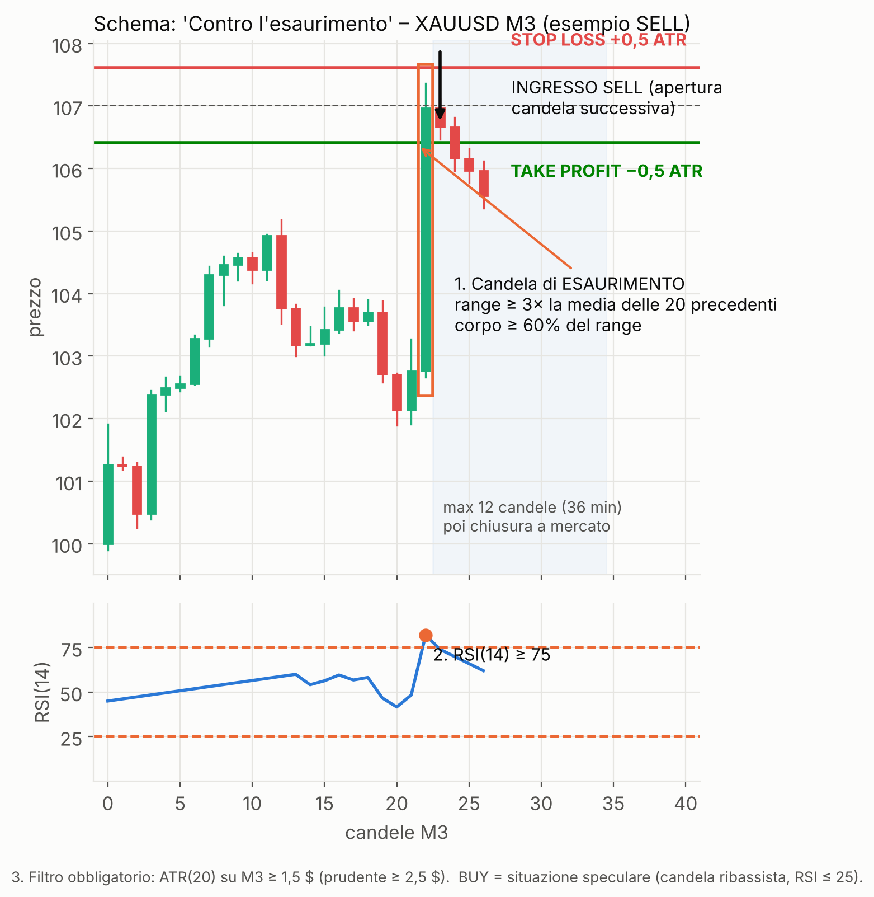
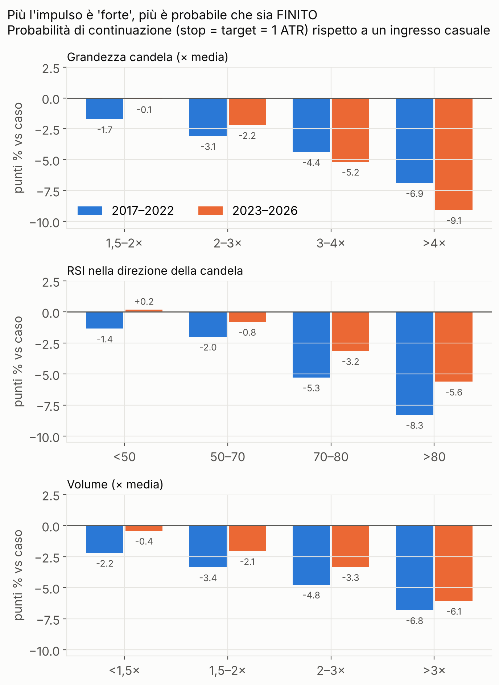
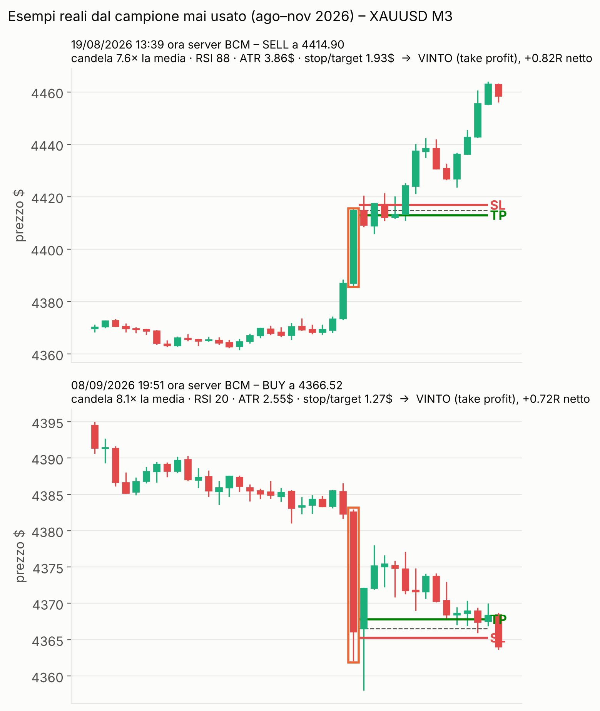
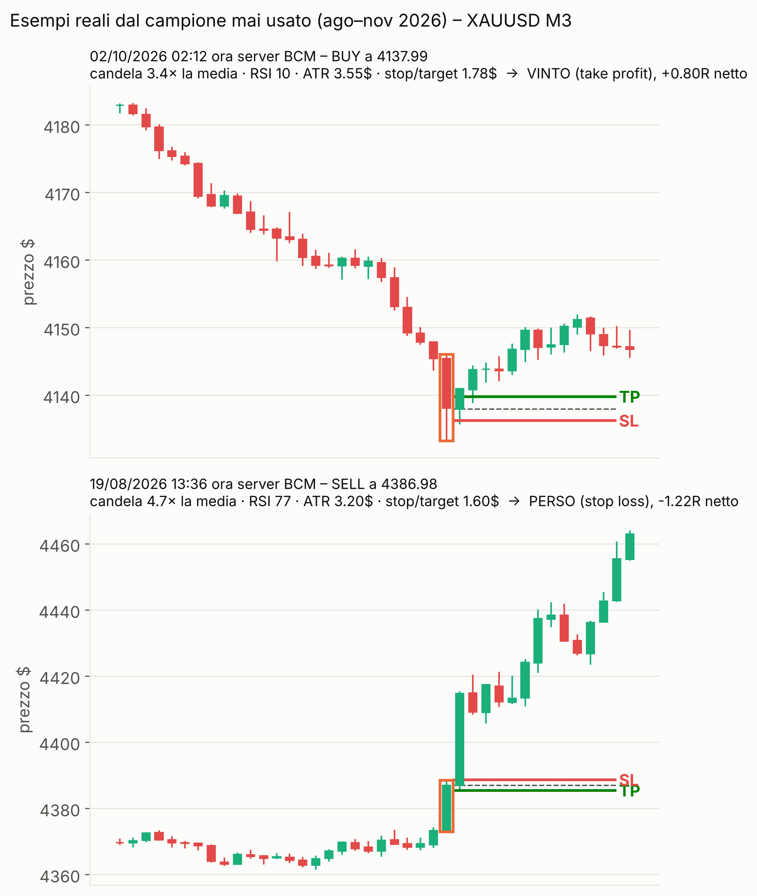
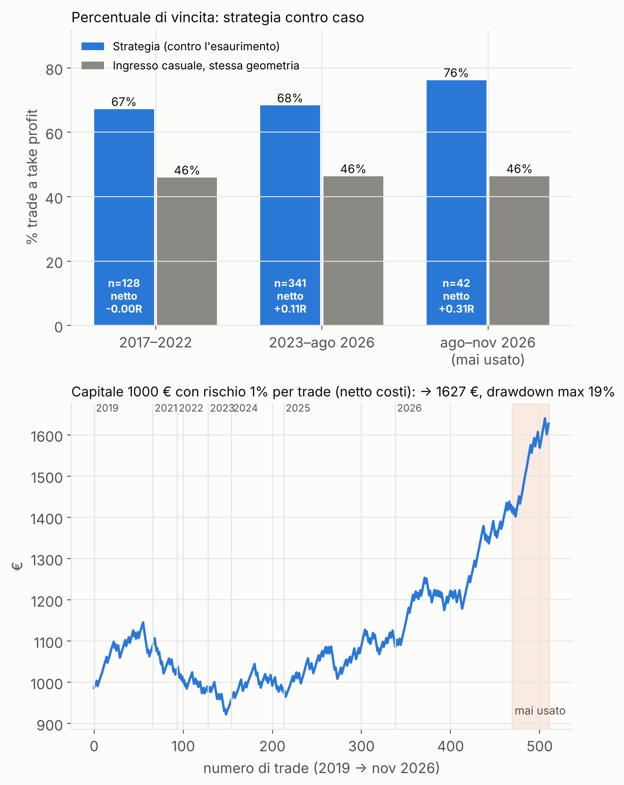

> **⚠️ DOCUMENTO RITIRATO (18/11/2026).** La strategia «Contro l'esaurimento» descritta qui **NON è profittevole**. I numeri del manuale (67–76% di trade vincenti) erano gonfiati da un errore di simulazione: nelle candele M1 in cui venivano toccati sia lo stop sia il target, il risultato veniva contato a favore del trade contrario. Con la simulazione corretta sui tick al secondo il risultato è 52–55% di trade vincenti e netto ≤ 0. TradingView (OANDA, 2024–2026) dà 55,5% e −34% del capitale. **Non usare questa strategia né l'Expert Advisor `ContraEsaurimento_XAUUSD.mq5`.** La strategia confermata è «Impulso–Pausa–Continuazione, M30, sessione New York»: vedi `tradingview/`.

# Introduzione

Questo manuale descrive una strategia di **scalping sull'oro (XAUUSD)** ricavata dall'analisi statistica di 9 anni e mezzo di dati al minuto (aprile 2017 – novembre 2026, circa 3,3 milioni di candele M1). Segue la struttura del documento *"Il Piano di Trading"*: money management, strategia operativa, regole di ingresso e uscita, gestione delle posizioni, verifica dei risultati, routine, errori e regole.

L'idea di partenza era *"lateralità → candela forte con volume → il mercato prende la direzione"*. I numeri hanno mostrato che **sui timeframe piccoli quella candela forte è più spesso la fine del movimento che l'inizio**. La strategia sfrutta quindi il movimento opposto: il ritracciamento dopo l'esaurimento.

**Come leggere i numeri.** "Netto" significa dopo spread (0,20 $, come BCM), slippage (0,05 $ per lato) e commissione (5,40 $ a lotto). "R" è il rischio di un trade: +0,3R vuol dire guadagnare in media il 30% di quanto si rischia. 1 pip = 0,10 $.

# 1. Struttura della strategia

## 1.1 Lo schema

**In tre passi:**

1. **La candela di esaurimento.** Una candela M3 almeno **3 volte** più grande della media delle 20 precedenti, con corpo pieno (almeno il 60% del range).
2. **L'RSI(14) è già tirato nella sua direzione:** ≥ 75 se la candela è rialzista, ≤ 25 se è ribassista.
3. **Si entra contro**, all'apertura della candela successiva, con **stop loss e take profit uguali: 0,5 ATR**. Se dopo 12 candele (36 minuti) il trade è ancora aperto, si chiude a mercato.

**Filtro obbligatorio:** l'ATR (range medio delle 20 candele M3) deve essere **almeno 1,5 $**. Sotto questa soglia lo stop è troppo piccolo e i costi si mangiano il vantaggio. Versione prudente: almeno 2,5 $.

## 1.2 Layout del grafico (MT5)

| Elemento | Impostazione |
|---|---|
| Strumento / timeframe | XAUUSD, **M3** |
| Indicatore 1 | **RSI(14)** sulla chiusura, livelli **25** e **75** |
| Indicatore 2 | **ATR(20)**: approssima il range medio delle 20 candele usato nel test |
| Volumi | tick volume (facoltativo: non è una condizione di ingresso) |
| Ora del server BCM | **UTC+1** in inverno (= ora italiana) |

## 1.3 Money management

| Regola | Valore |
|---|---|
| Rischio per trade | **1%** (2% solo dopo la conferma in demo) |
| Lotto | rischio € / (stop $ × 100). Esempio: 1000 €, rischio 1% = 10 €, stop 1 $ → **0,10 lotti** |
| Posizioni contemporanee | **una** |
| Pausa | dopo **6 perdite consecutive** (il massimo storico è 5): stop per la giornata e verifica del registro |

## 1.4 Regole di ingresso e uscita

| # | Regola | SELL | BUY |
|---|---|---|---|
| 1 | Candela segnale (chiusa) | rialzista, range ≥ 3× la media, corpo ≥ 60% | ribassista, range ≥ 3× la media, corpo ≥ 60% |
| 2 | RSI(14) a chiusura | **≥ 75** | **≤ 25** |
| 3 | Volatilità | ATR ≥ 1,5 $ | ATR ≥ 1,5 $ |
| 4 | Orario | 00:00–20:00 UTC (01:00–21:00 ora italiana/server in inverno), mai nei venerdì NFP 12–15 UTC | idem |
| 5 | Ingresso | a mercato all'apertura della candela successiva | idem |
| 6 | Stop loss | ingresso **+ 0,5 ATR** | ingresso **− 0,5 ATR** |
| 7 | Take profit | ingresso **− 0,5 ATR** | ingresso **+ 0,5 ATR** |
| 8 | Uscita a tempo | dopo 12 candele (36 min) | idem |
| 9 | Chiusura forzata | 20:45 UTC (21:45 ora server in inverno) | idem |

## 1.5 Gestione della posizione

- **Niente break even e niente chiusure parziali.** Con stop e target così vicini, spostare lo stop aggiunge solo costi. Su questa famiglia di pattern i test hanno mostrato che break even e parziali **peggiorano** il risultato.
- **Niente "lo tengo perché poi gira".** Lo stop è fisso. I dati mostrano che chi è già in perdita non ha probabilità di recupero superiori al caso.
- La posizione si chiude **solo** per TP, SL, tempo (36 min) o alle 20:45 UTC.

# 2. La prova statistica: perché "contro"

Il grafico confronta la probabilità che il movimento **continui** con quella di un ingresso **casuale**, alla stessa ora e con la stessa distanza di stop e target. Le barre blu sono il 2017–2022, quelle arancioni il 2023–2026.

- **Più la candela è grande**, più la continuazione è **meno** probabile del caso: oltre 4× la media, −6,9 e −9,1 punti percentuali.
- **Più l'RSI è tirato**, peggio: oltre 80, −8,3 e −5,6 punti.
- **Più volume c'è**, peggio: oltre 3× la media, −6,8 e −6,1 punti.

L'effetto è **identico nei due periodi**: non è un caso. Quando questi segnali coincidono, la probabilità passa dalla parte opposta, ed è lì che entra la strategia.

**Vincere spesso non basta.** Con target piccolo e stop largo si arriva all'85–90% di trade vincenti con *qualsiasi* ingresso, anche casuale, ma in perdita. Per questo ogni numero del manuale è confrontato con un ingresso casuale.

# 3. Esempi reali (campione mai usato: agosto–novembre 2026)

**Esempio 1 – 19/08/2026, 13:39 ora server – SELL a 4414,90.** La candela era 7,6× la media e l'RSI a 88. Il prezzo ritraccia di 1,93 $ (0,5 ATR) nella candela successiva. **Take profit, +0,82R netto.**

**Esempio 2 – 08/09/2026, 19:51 ora server – BUY a 4366,52.** La candela ribassista era 8,1× la media, con RSI a 20. Il rimbalzo arriva subito. **Take profit, +0,72R netto.**

**Esempio 3 – 02/10/2026, 02:12 ora server – BUY a 4137,99.** Siamo in fondo a una discesa lunga, la candela è 3,4× la media e l'RSI a 10. **Take profit, +0,80R netto.**

**Esempio 4 – 19/08/2026, 13:36 ora server – SELL a 4386,98. PERSO, −1,22R netto.** La candela successiva è stata un'altra candela enorme nella stessa direzione: è la **scala** (impulso → impulso). Questo è il caso in cui la strategia perde: l'esaurimento non era ancora arrivato. Tre minuti dopo, il segnale successivo dello stesso movimento (Esempio 1) ha vinto. Le perdite sono previste e già incluse nei numeri: circa **1 trade su 3**.

# 4. Risultati

| Campione | Trade | Vincenti | Ingresso casuale | Netto per trade |
|---|---|---|---|---|
| 2017–2022 | 128 | **67%** | 46% | 0,00R |
| 2023–ago 2026 | 341 | **68%** | 46% | +0,11R |
| ago–nov 2026 (**mai usato** per costruire la strategia) | 42 | **76%** | 46% | **+0,31R** |

- **Capitale:** 1000 € con rischio 1% per trade → **1627 €** (2019 – novembre 2026), **drawdown massimo 19%**.
- **Massimo di perdite consecutive:** 5.
- **Frequenza:** circa 13–15 segnali al mese con l'oro ai livelli attuali (0,5–0,7 al giorno). Nel 2017–2018 nessun segnale, perché l'oro valeva circa 1300 $ e l'ATR non arrivava mai a 1,5 $.
- **Anni deboli:** 2021–2023, con ATR basso. Il vantaggio "prima dei costi" è stabile in tutti gli anni. Il vantaggio **netto** c'è solo quando l'oro è volatile in dollari, come oggi.

# 5. È una strategia profittevole?

**Risposta onesta: è la prima strategia di questa ricerca che supera tutti i controlli statistici disponibili. È *plausibilmente* profittevole, non ancora *dimostrata* sul tuo conto.**

| Controllo | Esito |
|---|---|
| Regole scritte prima di guardare i risultati del campione mai usato | ✅ |
| Costi reali inclusi | ✅ |
| Funziona nel 2017–22, nel 2023–26 e nel campione mai usato | ✅ al lordo in tutti e tre; al netto 0,00 / +0,11 / +0,31R |
| Molto meglio del caso (67–76% contro 46%) | ✅ |
| Spiegazione logica (esaurimento dopo l'impulso) | ✅ |
| Profittevole in ogni regime di mercato | ❌ solo con ATR alto (come oggi) |
| Slippage reale su BCM subito dopo un picco | ⏳ **da misurare**: è il rischio principale |
| Test in demo su BCM | ⏳ da fare |

**Il punto debole:** il guadagno medio per trade è di circa **0,15–0,30 $ per oncia**, contro costi di circa **0,35 $**. Se su BCM lo slippage dopo i picchi è più alto di 0,05 $, il vantaggio si riduce molto. **Per questo il passo successivo è il test su BCM, non il conto reale.**

# 6. Backtest: chi li ha fatti e come rifarli su BCM / MT5

**I backtest di questo manuale li ho fatti io, in Python**, con questi dati:

- **storico 2017–ago 2026:** esportazione da un terminale MT5 (broker Exness, XAUUSD, M1, con spread reale);
- **ago–nov 2026:** tick reali Dukascopy (bid/ask di ogni quotazione).

**Non sono stati fatti sui dati BCM**, perché da qui non posso collegarmi al tuo MT5. Per rifarli sul tuo broker c'è l'Expert Advisor allegato: **`ContraEsaurimento_XAUUSD.mq5`**.

**Backtest su MT5 con i dati BCM:**

1. Copia il file in `File → Apri cartella dati → MQL5 → Experts`, aprilo in MetaEditor e premi **Compila**.
2. Apri il **Tester strategie**: Expert `ContraEsaurimento_XAUUSD`, simbolo **XAUUSD**, periodo **M3**.
3. Modalità: **"Ogni tick basato su tick reali"** (fondamentale: stop e target sono piccoli).
4. Date: il più indietro possibile (BCM potrebbe avere meno storia di tick).
5. Parametri: lascia i default. **`ServerGMTOffset = 1`** (BCM è UTC+1 in inverno). Se il backtest copre mesi estivi e il server segue l'ora legale, i risultati di quei mesi saranno sfasati di un'ora.
6. Confronta: % vincenti (atteso 65–75%), R medio, numero di trade al mese.

**Test in demo (dopo il backtest):**

1. Conto **demo BCM**, grafico XAUUSD M3, EA attivo con *Algo Trading* acceso.
2. Lascialo girare finché non ha fatto **almeno 30–50 trade** (2–3 mesi).
3. L'EA registra ogni trade in `Common\Files\ContraEsaurimento_log.csv`, con **prezzo richiesto, prezzo eseguito e slippage**. Questo file mi serve per l'analisi finale.

**Nota tecnica:** l'EA non è stato compilato qui (non c'è MetaEditor in questo ambiente). Se la compilazione dà errori, mandami il messaggio e lo correggo.

# 7. Routine

| Quando | Cosa |
|---|---|
| Prima della sessione | Calendario macro: annotare CPI, FOMC, NFP. L'EA salta solo gli NFP; per gli altri si può spegnere 30 minuti prima e dopo |
| Durante | Nessun intervento manuale sui trade dell'EA |
| Fine giornata | Controllo del log: trade eseguiti, slippage, eventuali segnali saltati per spread |
| Settimanale | % vincenti e R medio contro i numeri del manuale |

# 8. Analisi degli errori e criteri di stop della strategia

- **Registro:** il CSV dell'EA, più una nota per ogni intervento manuale (che non dovrebbe esserci).
- **Fermare la strategia se, dopo 30 trade:** % vincenti sotto il **55%**, oppure slippage medio oltre **0,15 $**, oppure R medio netto sotto **−0,10R**.
- **Non cambiare i parametri** prima di 50 trade reali: è la regola anti-overfitting del tuo piano.

# 9. Regole di trading

Valgono le regole 5.1–5.10 del *Piano di Trading*, con queste precisazioni:

- **5.1 Rischio:** 1% in fase di verifica.
- **5.4 Stop loss obbligatorio:** sempre a 0,5 ATR, inserito con l'ordine.
- **5.5 Gestione dinamica:** per questa strategia **niente break even e niente parziali** (vedi §1.5).
- **5.8 Monitoraggio:** l'EA gestisce tutto. Il monitoraggio serve a controllare l'esecuzione (slippage, spread), non a intervenire sui trade.

# Appendice: cosa è stato testato e scartato

| Idea | Esito |
|---|---|
| Seguire l'impulso su M1–M5 (la lettura "a occhio") | Smentito: i target vengono raggiunti meno spesso del caso |
| Scala di 6 ordini con TP da 20 a 100 pip + runner in trailing | Smentito: lordo circa 0, netto negativo in 160 combinazioni |
| Break even, uscite parziali, trailing | Non creano vantaggio (matematicamente non possono) |
| Primo impulso dopo lateralità su M30, New York | Plausibile ma solo circa 2 trade al mese (strategia secondaria) |
| Orari fissi, breakout dei range di Londra e New York, NFP | Nessun vantaggio stabile |
