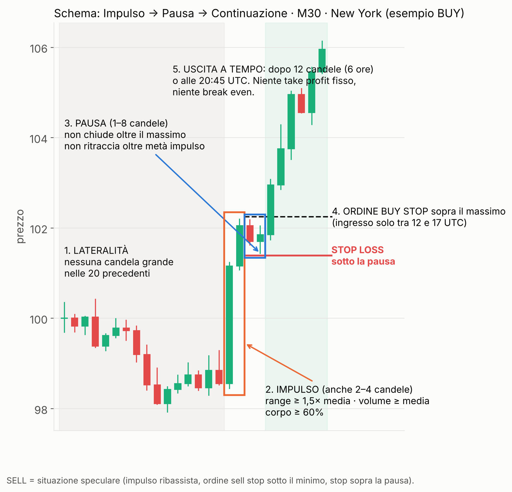
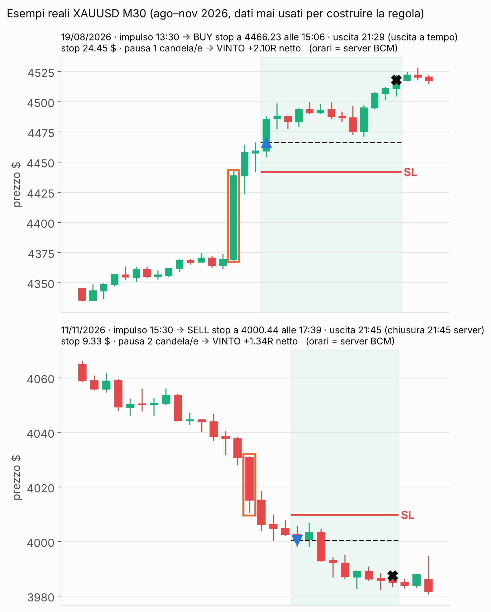
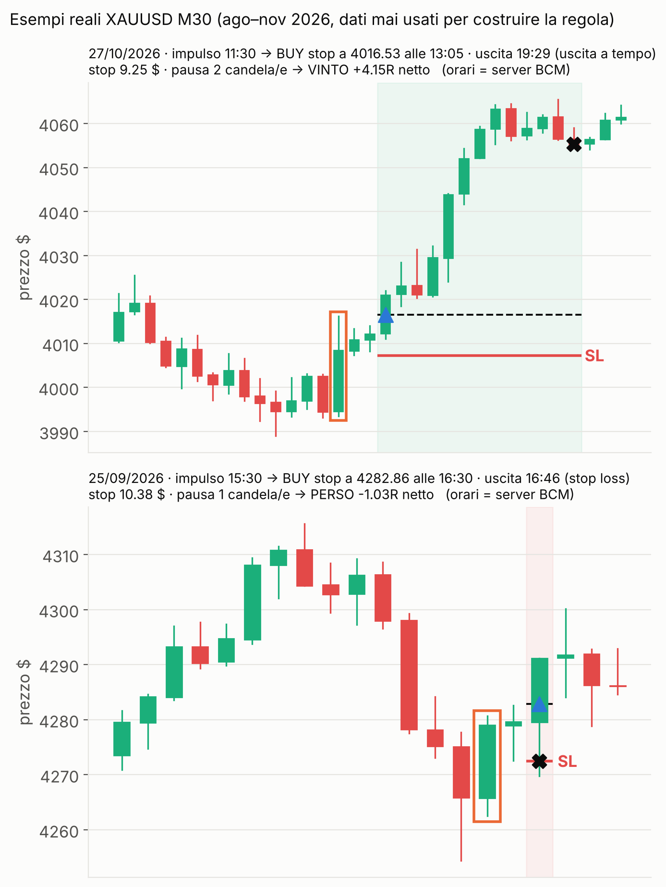
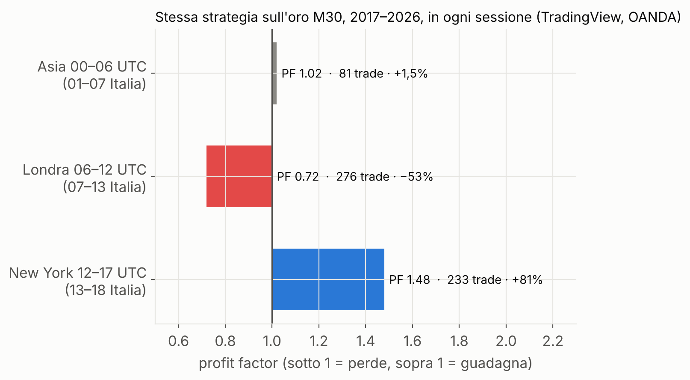
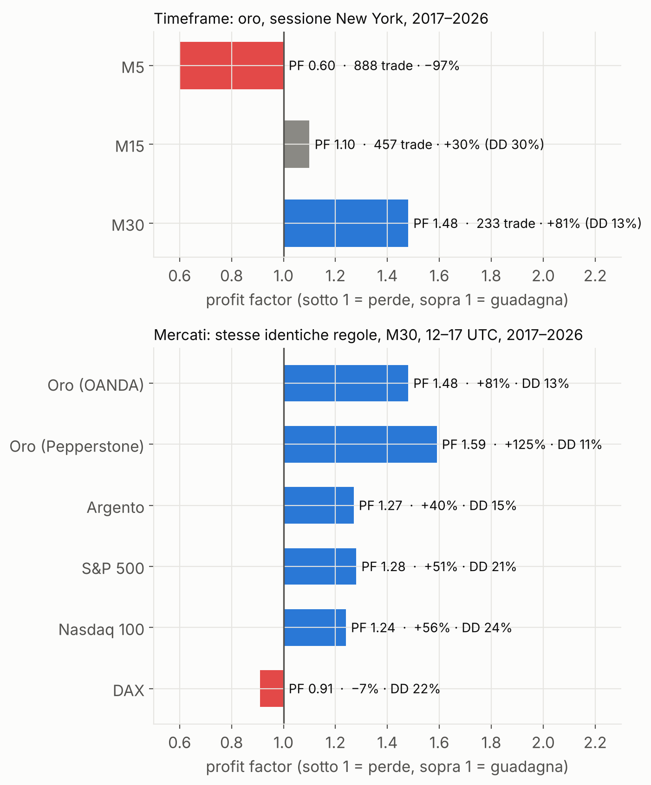
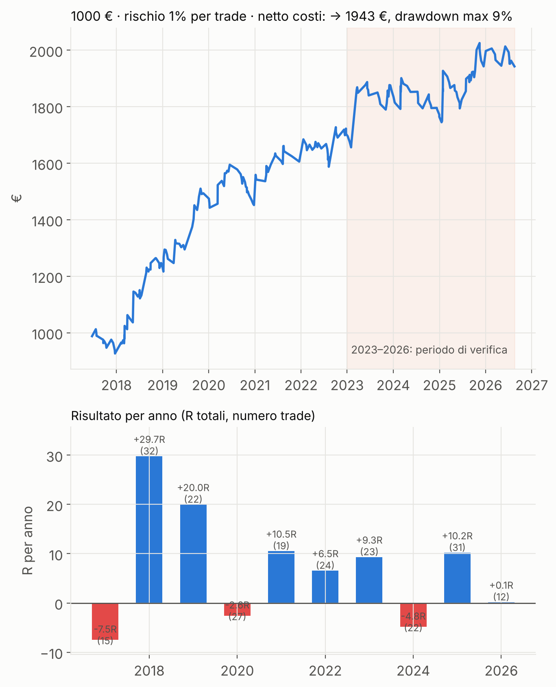

# Introduzione

Questa strategia è **la tua idea di partenza**: dopo una lateralità, il mercato fa un primo movimento forte con volume, si ferma per poche candele e poi riparte nella stessa direzione.

I test hanno mostrato **dove funziona e dove no**:

- funziona su **M30**, nella **sessione di New York** (12–17 UTC, cioè 13–18 ora italiana in inverno);
- **non** funziona su M1–M15, né nelle sessioni di Asia e Londra.

È stata verificata su **tre fonti dati diverse** (Exness, OANDA, Pepperstone), con **due motori di backtest diversi** (Python e TradingView) e su **cinque mercati**.

**Come leggere i numeri:**

- **Netto:** risultato dopo spread (0,20 $), slippage (0,10 $) e commissione (circa 0,054 $ per oncia).
- **R:** il rischio di un trade. +2R significa guadagnare il doppio di quanto si rischia.
- **Profit factor (PF):** guadagni lordi divisi per perdite lorde. Sopra 1 la strategia guadagna, sotto 1 perde.
- **1 pip** = 0,10 $.

# 1. Lo schema

**I cinque passi:**

1. **Lateralità.** Nelle 20 candele M30 precedenti non c'è nessuna candela grande (nessuna oltre 2 volte la media). Il mercato "dormiva".
2. **Impulso.** Arriva una candela, o una sequenza di 2–4 candele forti, con:
   - range almeno **1,5 volte** la media delle 20 precedenti;
   - **volume tick almeno pari alla media**;
   - **corpo pieno** (almeno il 60% del range).
3. **Pausa.** Seguono da 1 a 8 candele che **non chiudono oltre il massimo** dell'impulso (gli stoppini sono ammessi) e **non ritracciano oltre metà** dell'impulso.
4. **Ingresso.** Ordine **buy stop** 0,05 $ sopra il massimo della struttura (impulso + pausa), oppure **sell stop** sotto il minimo se l'impulso è ribassista. **L'ordine scatta solo tra le 12:00 e le 17:00 UTC.** Lo **stop loss** va 0,05 $ oltre il minimo (o il massimo) della pausa.
5. **Uscita.** **A tempo**: dopo **12 candele (6 ore)**, oppure alle **20:45 UTC** se arriva prima. **Niente take profit fisso, niente break even, niente chiusure parziali.**

**L'ordine si cancella** se la pausa supera 8 candele, se il prezzo ritraccia oltre metà dell'impulso, o se si esce dalla fascia 12–17 UTC.

## Orari per il server BCM (UTC+1 in inverno)

| Evento | UTC | Server BCM / Italia (inverno) |
|---|---|---|
| Inizio fascia di ingresso | 12:00 | 13:00 |
| Fine fascia di ingresso | 17:00 | 18:00 |
| Chiusura forzata | 20:45 | 21:45 |

# 2. Esempi reali (agosto–novembre 2026, dati mai usati per costruire la regola)

**19/08/2026 – BUY.**

- Impulso rialzista alle 13:30 (ora server), dopo una lunga lateralità.
- Una sola candela di pausa, poi l'ordine scatta alle 15:06 a 4466,23.
- Il prezzo prosegue e la posizione si chiude a tempo alle 21:29.
- **+2,10R netto.**
- Attenzione: lo stop era di 24 $, molto largo (vedi §4).

**11/11/2026 – SELL.**

- Discesa con impulso ribassista alle 15:30, poi due candele di pausa.
- Sell stop eseguito alle 17:39 a 4000,44. La discesa continua.
- Chiusura forzata alle 21:45 (ora server).
- **+1,34R netto.**

**27/10/2026 – BUY.**

- Impulso alle 11:30 ora server, quando la sessione di New York non era ancora aperta.
- Due candele di pausa. L'ordine scatta alle 13:05, già dentro la fascia.
- Da lì parte una salita di oltre 40 $.
- **+4,15R netto.**
- È il caso tipico in cui la scala di impulsi e pause che vedevi a occhio funziona.

**25/09/2026 – BUY, PERSO.**

- Rimbalzo dopo una discesa: impulso alle 15:30, una candela di pausa, ingresso alle 16:30.
- Il prezzo torna subito sotto la pausa e tocca lo stop in 16 minuti.
- **−1,03R.**
- Circa 6 trade su 10 finiscono così o in piccola perdita. La strategia guadagna perché i vincenti sono più del doppio dei perdenti.

# 3. Perché New York, perché M30, su quali mercati

**Stessa regola sull'oro, sessione per sessione:**

- **Asia** fa pari (PF 1,02). Anche quando il movimento c'è, come la notte del 18/11, in media il prezzo rientra all'apertura europea.
- **Londra** perde metà del capitale (PF 0,72): l'apertura europea è piena di **false rotture**.
- **New York** guadagna (PF 1,48): con i dati macro americani e i grandi volumi, dopo la pausa il movimento **prosegue davvero**.

**Timeframe:**

- **M5** azzera il conto: costi fissi su movimenti piccoli.
- **M15** è debole.
- **M30** è il primo timeframe in cui il movimento atteso supera con margine i costi.

**Mercati:** le **stesse identiche regole**, senza nessun ritocco, guadagnano su oro (due broker), argento, S&P 500 e Nasdaq 100. Perdono sul DAX, che alle 12–17 UTC è fuori dalla sua sessione principale. Che la regola funzioni su mercati diversi è la prova migliore che il pattern sia reale.

# 4. Risultati e capitale

| Metrica (oro M30, 2017–2026) | Valore |
|---|---|
| Trade | circa 230 (circa 2 al mese) |
| Trade vincenti | circa 41% |
| Vincita media / perdita media | circa +2,2R / −1R |
| Risultato medio netto per trade | **+0,32R** |
| Massimo di perdite consecutive | 6 |
| 1000 € con rischio 1% | **→ 1943 €**, drawdown massimo 9% |
| Anni negativi | 2017 (−7,5R), 2020 (−2,6R), 2024 (−4,8R) |
| 2026 fino ad agosto | circa 0 (+0,1R) |

**Verifica TradingView (OANDA M30):**

| Periodo | Trade | Profit factor | Netto | Drawdown max |
|---|---|---|---|---|
| 2017–2022 | 143 | 1,56 | +51% | 8,6% |
| 2023–2026 | 90 | 1,31 | +17% | 11,6% |
| Pepperstone, 2017–2026 | 252 | 1,59 | +125% | 10,8% |

# 5. Cosa sapere prima di usarla

1. **Non è scalping.** Un trade dura in media 4–6 ore. Si opera nel pomeriggio italiano e si chiude in serata.
2. **Pochi trade.** Circa 2 al mese sull'oro, circa 8–9 al mese aggiungendo argento, S&P 500 e Nasdaq. Ci sono mesi senza nessun segnale.
3. **Si perde spesso.** Circa 6 trade su 10. Il guadagno arriva da pochi trade grandi, quindi **non bisogna tagliarli** con break even o target.
4. **Conto piccolo.** Lo stop è strutturale: mediana circa 4 $, ma il 10% delle volte oltre 12 $. Con 1000 € e rischio 1% (circa 11,6 $) anche il lotto minimo di 0,01 rischia di più. Quei trade si saltano, oppure si accetta un rischio più alto.
5. **Il rendimento non è costante.** Ci sono anni negativi, e il 2026 finora è piatto.
6. **Non è ancora testata su BCM.** Tutti i numeri vengono da altri broker. Mancano lo slippage reale degli ordini stop nei momenti di notizie e lo spread BCM nel pomeriggio.

# 6. Prossimo passo

Expert Advisor MT5 con queste regole esatte, gli orari in UTC e la registrazione di slippage e spread, da far girare **in demo su BCM per 2–3 mesi**. Poi confronto con questi numeri prima di qualsiasi conto reale.

*Script e dati: branch `claude/backtest-xau-usd-forex-s5ahnh`, cartella `backtest/xauusd_impulse/` (script Pine in `tradingview/impulso_pausa_NY.pine`).*
